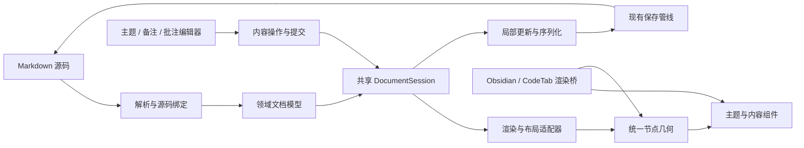

# Oh-My-Mindmap-Studio：下一阶段编辑器改造设计

> 状态：设计草稿，等待讨论；不是当前实现或 Markdown 格式标准。
> 日期：2026-11-23。
> 当前代码基线：`cef8e71`，插件版本 `0.3.3`；工作区已有文档草稿与 Agent 文档目录迁移，独立保留。
> 参考：gogoga-mindmap `9364cea` / `0.94.0`。

先读[改造摘要](#改造摘要)、[需要确认的决策](#需要确认的决策)和[实施路线](#实施路线)。数据与验收细节供实现时查阅。

## 改造摘要

- 将产品继续推进为完整的 Obsidian 导图编辑器，保留 Markdown 存储与已有流畅交互。
- 建立我们自己的文档与主题模型，将主题、Markdown 备注、引用和批注明确区分。
- 专用导图的中心主题成为内容，文件名只负责文件管理；两者仅在新建时允许使用同一个初始值。
- 统一主题与备注的输入接口、节点几何和组件生命周期；保留共享文档会话、自动保存与撤销基础。
- 支持分支方向的持久化，再逐步实现混合布局与更丰富的内容操作。
- 允许破坏性调整现有语义，但打开文件不自动迁移、规范化或补写数据。
- 引擎是否替换，通过第一阶段原型与测量决定；本稿不预先宣布更换。
- 功能和架构两条轨迹同时推进：在现有分层内建立能力模块、明确公共出口、收缩大 View/Context 的职责，并增加模块级依赖检查。
- 操作演示录制继续暂缓，功能和新数据协议稳定后再更新文档与 GIF。

## 已确认的目标与约束

- 产品体验
  - 节点创建、编辑、拖拽、缩放与折叠保持自然、流畅。
  - 简洁、克制，适应 Obsidian 明暗主题；次要操作通过菜单或选中态工具栏呈现。
  - 默认空白画布拖拽平移，保留已确认的用户偏好；框选手势继续可配置。
  - 新图保持空正文/无示例分支的体验，新协议落地后只创建真实中心主题。
- 数据与平台
  - 本阶段继续保存 Markdown，不引入 `.mindmap`、`.json` 或 `.xmind` 作为编辑存储格式。
  - 支持 Obsidian 本地文件、引用更新与正常离线编辑。
  - 保存与内容保真是不可牺牲的约束；仅打开和浏览不写盘。
  - 可以破坏旧语义；不要求维护历史格式别名、运行时兼容层或自动批量迁移。
  - 插件标识、命令 ID、发行配置和版权不随本次编辑器重构顺便更改。
- 协作
  - 设计稿先讨论，之后使用独立开发分支。
  - 按可验证的小步骤提交，每步记录摘要、依据、验证和人工验收边界。
  - 不自动推送、创建 Issue/PR 或发布；提交和安装按用户当轮授权执行。

## 现状与主要问题

| 现有基础 | 当前限制 | 改造方向 |
|---|---|---|
| `MdNodeData` 合并引擎 data 与 Markdown 元数据 | 内容语义、显示派生值和引擎字段紧密关联 | 文档模型独立，渲染适配器只接收投影 |
| 多类内容可以显示在节点中 | 主题与长备注缺少独立产品语义 | 短主题、详细备注、引用/批注各有展示和编辑面 |
| 中心是虚拟文件根 | 中心改动会影响文件名 | 新中心有明确 Markdown 内容来源 |
| 六种整图布局、结构拖拽 | 分支左右方向没有完整内容契约 | 增加方向数据和重开验证 |
| textarea、引擎 contenteditable、CodeTab 编辑器 | 不同输入面需要独立焦点与控件保护 | 统一接口与生命周期，保留各控件必要适配 |
| 节点外框、内容、插件组件动态测量 | 编辑框/选中态、重排/持焦控件需要额外协调 | 统一几何输出和活 DOM 保留条件 |
| 共享 `DocumentSession` 与保存管线 | 新模型尚未接入，需要同步调整快照、操作和映射 | 保留唯一权威树、撤销与保存职责 |

当前底层引擎有 `note` 字段，但它不等于已经拥有完整的 Markdown 备注解析、编辑、保存和视图交互能力。

## 对 gogoga 的借鉴边界

| 设计证据 | 值得借鉴 | 不直接照搬的部分 |
|---|---|---|
| `src/model.ts` 的 `text`、`note`、`callout` | 主题、备注、短标注分别建模 | 我们的引用、悬停批注不应直接等同于它的可见气泡 |
| `side`、`layout`、`float` 字段 | 布局信息有明确持久化来源 | 首批只做根分支左右方向，自由坐标后置 |
| `src/inline-editor.ts` 使用 CodeMirror 6 | 短文本的输入法、选区、格式与局部撤销统一 | 不按它的默认快捷键覆盖我们的用户偏好 |
| `src/live-note-editor.ts` 接入原生实时预览 | 文件上下文与 Markdown 备注编辑 | 私有类发现和 activeEditor 操作需防御式隔离与验证 |
| `CanvasHost` 注入宿主能力 | 布局/画布与 Obsidian 能力之间有端口 | 不整块复制约 1.1 万行的 `canvas.ts` |
| `ViewportStore` 使用库内本机存储 | 视口与内容状态分开 | 具体状态范围按本项目目标确定 |
| 主视图分别持有 `History` | 全文快照是一种实现 | 我们继续保留同文件共享的文档会话和撤销时间线 |

参考项目也没有彻底取消文件名同步：唯一首个 H1 可以成为根，但文件名根仍同步改名，`renameWithRoot` 默认开启。我们的目标需要明确取消中心与文件名的后续同步。

参考项目有 55 个测试文件；本地依赖未就绪，测试在缺少 esbuild 时未启动。当前没有可比的真实手感、移动端或大图性能数据，功能设计与源码组织的判断不能替代实机比较。

## 目标内容模型

以下是概念模型，不代表现有接口或已经确定的文件名。

| 概念 | 内容与职责 | 展示方式 |
|---|---|---|
| 中心/主题 | 行内 Markdown 标题、子主题、内容身份 | 简洁的主题框 |
| Markdown 备注 | 完整 Markdown 片段，允许列表、代码、callout、图片与表格 | 图标展开、侧面编辑区或独立卡片 |
| 引用 | 指向笔记、标题、块或 callout 所在块 | 小型引用标记，点击/悬停调用宿主能力 |
| 批注 | 用户补充的短说明，不要求有外部目标 | 小标记与悬停弹层，支持显式编辑 |
| 可见标注 | 批注的一种可选常显模式 | 节点旁气泡，计入布局；后续阶段实现 |
| 布局信息 | 分支侧别、继承/独立布局，后期自由主题位置 | 提供给布局适配器 |
| 源码绑定 | 原始片段、位置范围、解析基线与受影响区域 | 仅供解析、提交、保真和定位使用 |

- 文档模型是内容权威；引擎 data、DOM、尺寸缓存都是可重建投影。
- NodeId 与引擎 UID 分离。会话内移动、撤销和重排保留身份；跨解析优先复用持久锚点及源码映射。
- 普通打开不自动补写 ID。引用确实需要持久锚点时，通过唯一的标记/引用收口写入。
- 引用和批注的编辑各自修改对应内容；重排、选择、悬停和尺寸重测不产生正文事务。
- 用户新建批注默认有独立身份；重复引用同一已有脚注时遵循 Markdown 的共享定义语义。

## Markdown 数据契约：推荐方向

本节是待验证的候选协议。实现前先确认，再更新 [Markdown 权威标准](../markdown-mindmap-standard.md)，避免草稿成为第二份标准。

### 中心主题

- 专用 `.mindmap.md` 推荐使用唯一的首个 H1 作为真实中心；分支从 H2 或列表开始。
- 新建时可用文件名播种 H1 一次；之后改中心只保存内容，改文件名只更新文件上下文。
- 文件名规则不限制中心文本中的 `/`、`:`、`?` 等字符。
- 普通 Markdown 临时导图仍支持文档概览根，不因打开而加 frontmatter 或 H1。
- 没有 H1、多个 H1、空中心和层级跳跃必须有明确规则。
  - 专用文件格式不满足规则时不猜测、降级层级或自动写盘；保留原 Markdown/可读预览。
  - 用户显式编辑或转换才允许建立真实中心；是否提供一次性转换工具单独决定。
  - 普通笔记的概览根与专用中心不应共用重命名副作用。

### Markdown 备注

完整备注必须有可判定边界，否则备注中的列表会在重开时变成子主题。

- 推荐先验证显式 HTML 注释边界：`<!-- mindmap:note -->` 与 `<!-- /mindmap:note -->`。
  - 标记本身是 Markdown 中合法的 HTML 注释；内容仍使用普通 Markdown。
  - 备注编辑器接收边界内部的原文，不接收整篇笔记作为可写文件。
  - 这是一项候选内容约定，尚未确定为正式格式。
- 同时比较隐式标题正文/引用块方案。
  - 隐式方案阅读自然，但列表、嵌套引用和代码续行的归属更复杂。
  - 原生备注编辑器插入列表后，必须能够不变成主题地往返保存。
- 未闭合标记、嵌套边界和手动外部修改优先保留源码；不能因解析失败清空内容。

候选文件示例：

````markdown
---
Mindmap: Mindmap
Mindmap Layout: mindmap
---

# React 技术体系

## Hooks[^hooks-comment]
<!-- mindmap:note -->
> [!info] 状态与副作用
> 备注中的原生 callout。

- 检查依赖数组
- 保持 Hook 调用顺序

```js
const [count, setCount] = useState(0);
```
<!-- /mindmap:note -->

### useState

## 参考资料
- [[React 笔记#^example]]

[^hooks-comment]: 这里是一条可悬停查看的批注。
````

### 引用与批注

- 引用推荐沿用 `[[笔记#标题]]`、`[[笔记#^块ID]]` 等宿主语法，使用唯一链接解析器。
- 引用 callout 时指向对应块；是否嵌入内容由展示模式决定，不把快照当成来源。
- 悬停批注优先验证标准脚注作为存储：节点引用标记对应脚注定义。
- 共享脚注、删除节点后的引用清理、脚注顺序和未解析目标进入往返测试。
- gogoga 的 `%%callout%%` 气泡是另一种内容展示；首批不同时引入两份批注存储。

### 布局和状态

- 整图布局继续保持单一文件配置来源。
- 分支侧别推荐 `auto/left/right`；首批只固定中心的直接分支，后代继承方向。
- 分支标记语法复用/扩展本项目现有指令体系，阶段 0 确认具体写法与导出边界。
- 内容身份、引用、方向和自由位置属于可跨设备的文档数据。
- 视口、缩放、当前选择、弹层位置属于本机编辑状态，推荐使用 Obsidian 的库内本机存储 API。
- 折叠状态需确认是文档状态还是本机状态；只保留一个权威来源，打开不补写。
- 自由位置只有在持久化、拖回结构节点、撤销和重开一致性齐备后才开放。

## 架构与职责



- `domain/`：文档、主题、批注/引用与布局值语义，不能读取引擎或 DOM。
- `markdown/`：新协议解析、源码绑定、保真更新和序列化。
- `services/`：共享会话、操作接收、冲突处理、撤销和保存；继续复用现有基础。
- `core/`：输入接口与共享机制，继续复用 `EditorInputSurface` 等窄接口。
- `engine/`：领域模型投影与布局/渲染适配，继续通过 `mindmap.ts` 收口。
- `platform/`：文件上下文、原生 Markdown 编辑/渲染、第三方 API、本机状态。
- `ui/`：主题框、编辑组件、备注/批注弹层的骨架、局部样式和输入行为。
- `features/`：用户操作编排；不新增第二份解析器、写盘路径或引擎内部访问。

这是现有分层上的职责调整，不预先创建新一级模块或空壳目录。具体新文件随经过验证的实现计划登记。

### 当前目录是否过于平铺

当前情况不是整个 `src` 没有组织，而是分层约束比较明确，层内模块边界仍然偏弱。

| 当前层 | 根部文件 / 总文件 | 判断与调整方向 |
|---|---|---|
| `features` | 2 / 48，已有 7 个子目录 | 已按能力分组；继续收缩 `view` 和共享上下文，明确控制器与模块 API |
| `platform` | 1 / 27，已有 3 个子目录 | 保留现有能力分组，按编辑器、渲染插件、工作区能力定义出口 |
| `ui` | 9 / 42，已有 5 个子目录 | 组件骨架、样式和内部交互旁置；复杂主题/备注/批注组件各自成模块 |
| `engine` | 21 / 21 | 按实例、节点、视口、主题、导出等内聚职责收拢，保留单一引擎防腐入口 |
| `markdown` | 16 / 16 | 新文档协议聚合解析、源码绑定、序列化；低层语法工具保持明确归属 |
| `services` | 10 / 10 | 文档会话、历史、注册表、保存构成文档能力模块；渲染控制另行收口 |
| `domain` / `core` | 16 / 16、14 / 14 | 纯叶子模块可以平铺；领域文档等多文件能力再聚合，core 不作为杂项容器 |

这里的数值是设计时的目录观察，不作为机械拆文件的目标。是否成模块看共同状态、对外契约、变化频率与依赖方向。

### 模块公共出口与 index.ts

- 当前没有普遍使用 `index.ts`，来自现行“不新增无必要转发入口”的约定，并非 TypeScript 技术限制。
- 已有公共门面：`engine/mindmap.ts` 收口多个引擎子文件，它承担了模块入口的职责。
- 推荐调整为“能力模块有明确公共出口”，允许使用 `index.ts`；单文件叶子模块不强制建目录或 index。
- `index.ts` 本身只导出 API 和公开类型，不注册事件、创建服务或执行初始化。
- 新模块入口优先使用显式具名导出，不把所有内部文件 `export *` 到外部。
- 模块内部使用内部文件路径，不反向 import 自己的 index，避免初始化顺序和循环依赖。
- 跨模块消费公共出口；只有明确登记的适配/叶子共享接口允许例外深层路径。
- 直接测试纯逻辑时可以导入内部文件，不为测试把实现细节扩大为公共 API。
- 引擎现有门面先保留；后续是继续用 `mindmap.ts` 还是归一为 index，只保留一个正式入口。
- 增加 index 不能代替职责拆分，也不能解决巨型 Context 把整个视图暴露给业务模块的问题。

概念示例，尚未创建这些文件或接口：

```ts
// features/editing/index.ts：仅定义该能力的公开面
export { createEditingController } from './controller';
export type { EditingPort, EditingOptions } from './contracts';

// 模块内部 controller.ts 导入自己的实现文件，不导入 ./index。
// 外部组合根通过 features/editing 的公共出口装配。
```

### 目标组织方式

推荐“第一层分职责，第二层聚合能力”。下列目录用于表达方向，实际文件随实现产生，不先机械移动所有文件。

```text
src/
  domain/
    document/        # 主题、备注、批注/引用、操作与公开模型
    url.ts           # 单文件叶子模块可以保持原样
    wikilink.ts
  core/
    editor-input.ts  # 通用窄接口和机制
  markdown/
    document/        # 新协议解析、源码绑定、序列化与入口
    syntax/          # 内部语法能力，需要时成组
  services/
    document/        # 会话、注册表、历史和保存协调
  engine/
    mindmap.ts       # 过渡期唯一对外防腐入口
    adapters/        # 领域投影和引擎差异
    viewport/
    nodes/
    theme/
  platform/
    rendering/       # Obsidian 编辑/渲染与第三方桥
    workspace/
    system/
  ui/
    topic/           # DOM、内部交互、样式、编辑展示
    note/
    annotation/
  features/
    editing/         # 内容编辑与文档操作编排
    content/
    canvas/
    relations/
    view/            # 轻量视图宿主与装配
  main.ts            # 组合根
```

- 组件内部输入、焦点、DOM 和样式内聚于组件；文件写回、文档操作与平台能力通过注入连接。
- UI 与业务控制器不因功能同名就互相访问内部实现；以公开 Props、Ports 和操作接口连接。
- 新控制器接受最小能力接口，不接受完整 MindMapView，不依赖 view/context 的庞大接口合集。
- main/View 保留 Obsidian 生命周期和组合职责，将编辑、内容、布局等状态交给对应控制器。
- 公共类型归其所属模块；只有跨层的通用词汇和机制才放 core，不建立新的“大公共 types 文件”。

### 可执行的模块边界

- 继续以 `scripts/module-boundaries.mjs` 作为唯一依赖许可定义。
- 在现有层级许可之外，增补能力模块的公共入口和深层访问规则；不在 ESLint/测试配置各抄一份矩阵。
- 继续检查循环，并覆盖入口 re-export、类型引用、模块新增和深层导入。
- 先为试点模块建立规则，再随能力模块迁移扩展；不一次强制所有叶子文件通过新 index。
- 获得方案确认后再更新现行 K210/架构约定和门禁，本次只记录候选规则。

## 统一编辑与节点几何

- 主题编辑推荐 CodeMirror，保持共同文本、选区、范围替换、来源路径和销毁接口。
- 备注编辑推荐 Obsidian 实时预览；私有编辑器触点隔离、登记，失败可以使用普通输入面。
- 文件上下文只用于解析链接和插件内容；片段修改通过文档会话，不绑定第二个整文件写盘器。
- 未提交草稿的局部输入撤销可以由编辑控件负责；已接受内容的文件级历史只由 DocumentSession 负责。
- 几何输出同时描述主题、可见备注/标注、外框、选中态、命中区域与连线锚点。
- 展示与编辑使用同一几何来源；达到宽度上限后自然换行，主题内不引入纵向滚动条。
- 备注中的长代码、表格等按其编辑容器策略滚动，不能把主题框滚动策略直接套给所有内容。
- 正文编辑和实际持焦控件都需要保留活 DOM；输入法期间、候选选择和尺寸重排不触发外部提交。
- 缓存以内容/样式签名和正确身份失效，不能用历史 HTML 回灌源码或复制事件组件。

## 保存、撤销与外部修改

- 同文件多视图继续共享一份权威文档、一条文件级撤销线和一条保存管线。
- 重命名主题、修改备注/批注、移动分支、固定方向作为可描述的内容操作。
- 视图、布局缓存和插件组件接收投影；不通过整树陈旧快照覆盖权威文档。
- 仅实际内容/文档状态提交排保存；选择、缩放、悬停、预测量和异步 SVG 就绪不排正文保存。
- 外部 Markdown 改动沿用冲突机制，保留草稿/撤销恢复入口并取消陈旧写盘。
- 文件重命名迁移会话、路径上下文和本机状态，不覆盖中心主题。
- 未改动源码片段保留原文；未知语法和不支持的插件块可读并保留，不静默删除。

## 引擎选择的验证闸门

| 路线 | 收益 | 主要成本 | 推荐位置 |
|---|---|---|---|
| 现有引擎 + 独立领域模型 | 保留已验证手感和布局，先隔离内容语义 | 需要验证几何、编辑面和方向投影是否足够 | 阶段 0 默认验证路线 |
| 自研/复用 gogoga 风格的布局与画布 | 更自由地统一备注、标注与分支几何 | 完整负责拖拽、导航、输入、缩放、导出与性能 | 同协议的小型对照原型 |
| 改用 gogoga 为新底座 | 获得更多现成功能 | 重新接入当前保存/多视图/插件桥，重新评估交互与维护边界 | 单独评估，不默认为本次方案 |

- 原型比较同一份领域数据和相同交互场景。
- 测量打字、拖拽反馈、大图打开、内容增高和活组件重排；记录实际结果。
- 若现有引擎需要持续增加侵入补丁才能通过核心验收，再提出替换决策与成本。
- 不只凭功能数、截图或自研标签判断引擎优劣。
- gogoga 为 MIT；实际复用代码时保留版权和许可，另行核对所带依赖。

## 实施路线

每期同时交付功能和架构边界；目录整理只是其中一部分。

| 阶段 | 可独立交付内容 | 进入下一阶段的条件 |
|---|---|---|
| 0：协议与原型 | 确认根、备注边界、批注/引用、ID与状态规则；节点编辑/几何对照原型 | 往返性质与核心真实场景通过，明确引擎路线 |
| 1：文档模型 | 新解析/源码绑定/序列化、领域模型接入共享会话、独立中心主题 | 普通浏览不写盘，外部修改、多视图、重命名和撤销稳定 |
| 2：编辑与内容 | 统一主题编辑、Markdown 备注、引用标记与悬停批注、活组件保护 | 长内容/IME/补全/CodeTab 保存及几何验收通过 |
| 3：方向与呈现 | 分支左右持久化、拖拽预览、统一选中/命中/连线、渐进 UI 调整 | 重开保持方向，取消拖动与撤销不留自由坐标 |
| 4：增强能力 | 分屏定位、可编辑嵌入、常显标注、混合布局、自由主题 | 每项分别完成内容契约与回归，不挤进首批 |
| 5：文档与发行 | 更新使用指南、全套 GIF、发布说明与格式标准 | 用户验收，门禁与打包/安装检查完成 |

| 对应阶段 | 架构交付 | 验收依据 |
|---|---|---|
| 0 | 模块职责图、公开 API/Ports、入口策略、当前依赖与循环基线 | 一个试点模块可以通过出口消费，内部没有新增反向依赖 |
| 1 | 文档领域/Markdown/会话能力聚合，引擎 data 从领域权威模型退出 | 文档操作不要求引擎对象，保存、撤销和源码映射只各有一份实现 |
| 2 | 编辑与内容控制器、组件内聚，拆掉对大 ViewContext 的不必要依赖 | 主题、备注和批注可以用窄接口独立验证，生命周期有唯一 owner |
| 3 | 布局适配与几何职责收口，主题/视口/节点等引擎内部能力整理 | UI 不直读引擎形态，选中框/连线/命中区域来自统一几何 |
| 4–5 | 模块入口与深层访问规则扩展，文档与索引清理 | 新增能力有归属，公开 API 未暴露整个内部目录，门禁覆盖真实依赖图 |

- 阶段内允许重构与功能在同一分支推进；提交按职责/验证边界拆开。
- 每步记录改动摘要、决策依据、真实验证、遗留限制和下一步条件。
- 阶段完成后交用户审查，不用一个巨大提交累积所有改造。
- XMind 导入、PDF 导出、完整表格编辑、FSRS 复习与移动端增强不是首批必做项。

## 首批验收

- [ ] 专用导图新建真实中心；改中心不改文件名，改文件名不改中心，重开一致。
- [ ] 仅打开、浏览、缩放、选择和异步渲染不改正文。
- [ ] 备注中的列表、代码围栏、callout、图片、表格和空行保存重开不变成主题或丢失。
- [ ] 引用/批注展示与编辑各有正确来源，悬停和尺寸更新不保存旧源码。
- [ ] 输入法、选区、Enter/Tab/Esc、双链补全和输入局部撤销行为明确且稳定。
- [ ] 长主题自然换行，编辑外框/选中态/连线与内容尺寸一致。
- [ ] CodeTab 切页、编辑正文/标题、保存、取消、卸载和导出保持正确，普通代码仍可读。
- [ ] 分支侧别能持久化；拖动无目标回原结构，手势默认仍为拖拽平移。
- [ ] 同文件多视图同步、文件级撤销/重做与外部修改保留正确内容和草稿。
- [ ] 图片、标签、任务、脚注、已有关系/概要和 PNG/SVG 导出没有直接回归。
- [ ] 解析/往返生成式性质、领域操作、模块边界、DOM 与真实 Obsidian 场景按阶段验证。
- [ ] 试点能力的公开出口、内部导入和跨模块深层访问规则可执行；入口文件不引入副作用或循环。
- [ ] 新控制器不依赖完整 View 实例，组件骨架/样式/内部交互内聚，文档与平台职责经窄接口注入。
- [ ] 性能使用改造前后同样样本比较；未跑过的项目保留待验证状态。

测试至少覆盖：无/多 H1、空/特殊字符中心、嵌套备注围栏、未闭合边界、重复引用、Unicode/换行、节点删除/重排、文件移动、并发视图和保存冲突。性能样本采用 500/5000/10000 节点及包含插件内容的真实样本，数值阈值在阶段 0 基线实测后确定。

## 需要确认的决策

1. **新 Markdown 根与备注协议**：推荐专用图唯一首个 H1 + 明确备注边界；先比较原生阅读效果和复杂备注往返，再冻结标准。
2. **批注与引用**：推荐标准脚注承载悬停批注、原生链接承载引用；常显气泡作为后续展示模式。
3. **跨解析身份与折叠状态**：哪些节点需要持久锚点、折叠是否跨设备同步，必须有唯一来源。
4. **引擎路线**：默认先验证现有引擎适配，同时用同协议的小型对照原型评估替换价值；数据协议与会话边界先独立。
5. **模块与公共入口策略**：推荐分层内能力聚合、受控 index/命名门面、模块内禁反向 import 入口；先试点文档/编辑模块，再扩展依赖门禁。

这五项会影响正确实现与后续维护，阶段 0 必须明确。其它按钮位置、圆角和颜色可在原型与人工验收中渐进决定。

## 源码依据

- 本项目：[节点 data 边界](../../src/core/node-data.ts)、[Markdown 元数据](../../src/domain/md-meta.ts)、[共享会话](../../src/services/document-session.ts)、[会话注册表](../../src/services/document-session-registry.ts)。
- 本项目：[共同输入接口](../../src/core/editor-input.ts)、[编辑组件](../../src/ui/node-editor/node-editor.ts)、[内容写回](../../src/features/content/node-content-write.ts)、[第三方渲染桥](../../src/platform/rendering/plugins/bridge.ts)。
- gogoga 固定快照：[主题模型](https://github.com/JackWeiGogoga/gogoga-mindmap/blob/9364cea/src/model.ts)、[根与标记解析](https://github.com/JackWeiGogoga/gogoga-mindmap/blob/9364cea/src/markdown.ts)、[布局](https://github.com/JackWeiGogoga/gogoga-mindmap/blob/9364cea/src/layout.ts)。
- gogoga 固定快照：[短文本编辑器](https://github.com/JackWeiGogoga/gogoga-mindmap/blob/9364cea/src/inline-editor.ts)、[原生备注编辑器](https://github.com/JackWeiGogoga/gogoga-mindmap/blob/9364cea/src/live-note-editor.ts)、[视图写回](https://github.com/JackWeiGogoga/gogoga-mindmap/blob/9364cea/src/view.ts)、[状态](https://github.com/JackWeiGogoga/gogoga-mindmap/blob/9364cea/src/state.ts)。
